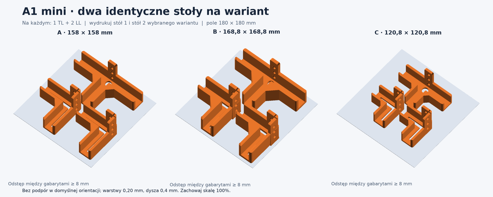

# Druk 3D — przydasie

Parametryczne projekty użytkowe do samodzielnego druku 3D: źródła CAD, gotowe STL, dokumentacja i wyniki weryfikacji geometrii.

## Uchwyty stolarskie TL / LL — płyta 18 mm

Nasadki typu „trzecia ręka” do ustawiania płyt pod kątem 90°. Zestaw: **2 TL + 4 LL**, trzy warianty konstrukcji, druk na Bambu Lab A1 mini.

**Zacznij od [instrukcji wydruków testowych i doboru pasowania](carpentry-third-hand/docs/test_prints.md).**

- [Opis projektu i parametry OpenSCAD](carpentry-third-hand/README.md).
- [Próbnik czterech luzów — STL](carpentry-third-hand/stl/fit/fit_all_4.stl?raw=true).
- [Gotowe STL: A referencyjny](carpentry-third-hand/stl/reference), [B wzmocniony](carpentry-third-hand/stl/reinforced), [C kompaktowy](carpentry-third-hand/stl/compact).
- [Ustawienia druku](carpentry-third-hand/docs/printing.md) i [użytkowanie](carpentry-third-hand/docs/usage.md).
- [Weryfikacja geometrii i jej ograniczenia](carpentry-third-hand/docs/validation.md).

Do codziennego użytkowania przewidziano wariant **B `reinforced` z PETG**, po sprawdzeniu pasowania i próbnym montażu. Dostarczone uchwyty mają szczeliny 18,30 mm.

Modele przeszły walidację komputerową. Nie wykonano jeszcze fizycznego wydruku ani prób obciążeniowych; ustawienia druku są punktem startowym do testów.
