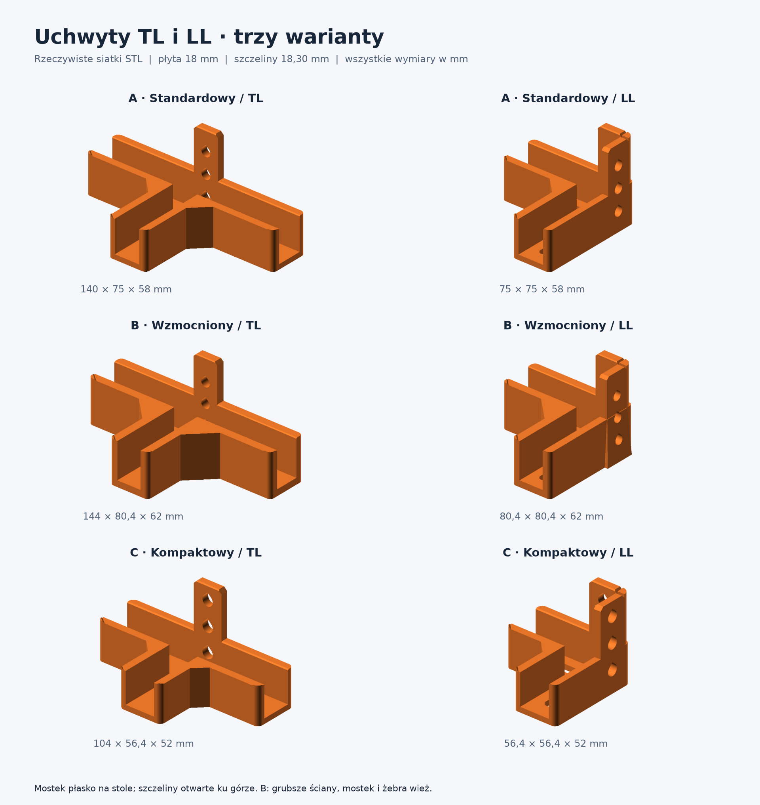
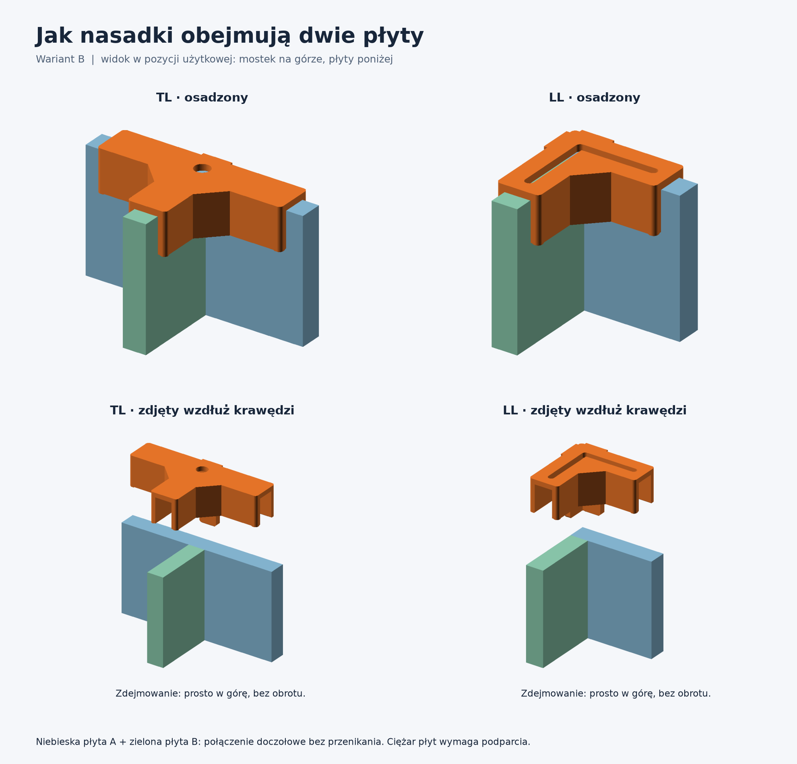

# Uchwyty stolarskie TL / LL — „trzecia ręka”, płyta 18 mm

Gotowy, parametryczny projekt OpenSCAD do druku FDM na Bambu Lab A1 mini. Zestaw roboczy: **2 TL + 4 LL**, rozłożony na **dwa stoły**. Jednostka STL: **milimetr**.

**Do codziennej pracy polecam wariant B — `reinforced` w PETG**, po sprawdzeniu pasowania próbką i wykonaniu próbnego narożnika. Jest sztywniejszy konstrukcyjnie; jego nośności i trwałości nie potwierdzono jeszcze próbami fizycznymi.



## Co jest gotowe

- 6 osobnych modeli uchwytów: TL i LL w wariantach A/B/C.
- 6 STL stołów: po dwa na wariant, każdy zawiera 1 TL + 2 LL.
- 4 próbki szczeliny: 18,2 / 18,3 / 18,4 / 18,5 mm oraz wspólny stół próbek.
- 4 STL poglądowych płyt 18 mm; demonstracja montażu i zdejmowania w OpenSCAD.
- Raport pomiarów rzeczywistych siatek, kolizji bryłowych, kontaktu płyt i szczelności: [walidacja](docs/validation.md).

Łącznie **21 STL**. Płyty z `stl/demo` służą do kontroli geometrii i nie są elementami zestawu do wydrukowania.

## Zasada działania

Uchwyty są nasadkami na **wspólne, odsłonięte krawędzie** dwóch płyt. Mostek spoczywa na krawędziach, a pionowe ścianki obejmują obie grubości. Szczeliny mają prostopadłe płaszczyzny bazowe; nie są jedynie ozdobnym obrysem litery.

**TL** ustawia przegrodę doczołowo do powierzchni drugiej płyty, w środku jej długości. **LL** obejmuje zewnętrzny narożnik. W obu przypadkach płyty stykają się bez nakładania swoich objętości. Nasadkę zdejmuje się wzdłuż krawędzi, prostopadle do mostka, również po skręceniu płyt — jeśli nic nie blokuje tej drogi.



Luz dodatni ułatwia zakładanie, lecz nie wytwarza docisku. Dociśnij płyty do baz, podeprzyj ich ciężar i sprawdź kąt. Przy dużych płytach użyj kilku nasadek oraz ścisków do właściwego docisku połączenia. Narzędzie nie służy do podnoszenia korpusów.

## Warianty i gotowe pliki

| Wariant | Budowa | TL, gabaryt [mm] | LL, gabaryt [mm] | STL do druku zestawu |
|---|---|---|---|---|
| A `standard` | Wersja standardowa, ściana 5 mm | 140 × 75 × 58 | 75 × 75 × 58 | [stół 1](stl/standard/plate_1_standard.stl), [stół 2](stl/standard/plate_2_standard.stl) |
| B `reinforced` | Ściana 6 mm, mostek 4,8 mm, większe wzmocnienia i żebra wież | 144 × 80,4 × 62 | 80,4 × 80,4 × 62 | [stół 1](stl/reinforced/plate_1_reinforced.stl), [stół 2](stl/reinforced/plate_2_reinforced.stl) |
| C `compact` | Krótsze ramiona, ściana 4,4 mm, mniejsze zużycie materiału | 104 × 56,4 × 52 | 56,4 × 56,4 × 52 | [stół 1](stl/compact/plate_1_compact.stl), [stół 2](stl/compact/plate_2_compact.stl) |

Oba stoły danego wariantu są celowo identyczne: każdy drukujesz raz. Zamiast tego możesz dwukrotnie wydrukować `plate_1`. Osobne modele TL/LL znajdują się obok plików stołów.

## Najpierw próbnik

**[Pełna instrukcja wydruków testowych — pliki STL, ustawienia i kryteria wyboru luzu](docs/test_prints.md).**

1. Zmierz suwmiarką grubość rzeczywistych płyt, w kilku miejscach i razem z okleiną.
2. Wydrukuj [cztery próbki](stl/fit/fit_all_4.stl) z tego samego PETG i przy tych samych ustawieniach co uchwyty.
3. Oznaczenia `0.2`, `0.3`, `0.4`, `0.5` oznaczają **całkowity** dodatek do nominalnych 18 mm. Nie są luzem na każdą stronę.
4. Wybierz najciaśniejszą próbkę nasuwającą się ręką, bez klinowania i wyginania ścian. Powinna się swobodnie zdejmować i nie rysować laminatu.
5. Jeżeli wybrany dodatek różni się od 0,3 mm, ustaw `clearance` i **ponownie wygeneruj uchwyty oraz stoły**. Dostarczone STL zawsze mają szczelinę 18,3 mm.
6. Wydrukuj jeden TL i jeden LL, sprawdź pełny chwyt na odpadach płyt i kątownikiem. Dopiero potem wykonaj cały zestaw.

Próbka sprawdza szerokość lokalną, a nie wszystkie odkształcenia dużego wydruku. Gdy żadna nie pasuje, zmień `board_thickness` lub dodatek i wykonaj nowy próbnik.

## Zmiana parametrów i eksport

Otwórz [src/config.scad](src/config.scad), wybierz `variant`, a następnie otwórz [handle_TL.scad](src/handle_TL.scad) lub [handle_LL.scad](src/handle_LL.scad). F6 wykonuje pełny render; potem eksportuj STL. `print_layout.scad` przygotowuje stół. `demo.scad` pokazuje użycie; zmień `demo_type` i `removal_distance`.

```scad
variant = "reinforced";
board_thickness = 18;
clearance = 0.3;
arm_length = 0;       // 0: automatycznie; B daje 72 mm
wall_thickness = 0;   // B: 6 mm
include_guide_holes = true;
```

Nie skaluj STL w slicerze: zmieniłoby to również szczeliny i otwory. Znaczenie wszystkich wymiarów, osie i ograniczenia: [dimensions.md](docs/dimensions.md).

Eksport całego kompletu w Windows, z katalogu projektu:

```powershell
powershell -ExecutionPolicy Bypass -File .\scripts\export.ps1
```

W systemie z OpenSCAD w PATH i Pythonem 3.7+:

```bash
bash scripts/export.sh
```

Można wskazać program zmienną `OPENSCAD` albo opcją `--openscad`. Przykład pojedynczego modelu w PowerShell:

```powershell
& 'C:\Program Files\OpenSCAD\openscad.exe' -o TL_custom.stl -D 'variant="reinforced"' -D 'clearance=0.4' src/handle_TL.scad
```

Na Windows skrypt Python czeka na zakończenie `openscad.exe` i zapisuje logi. Nie wymaga nakładki `openscad.com`. Przy niepoprawnych kombinacjach wymiarów asercje zatrzymują eksport. Nazwy plików próbek/płyt demonstracyjnych zawierają nominalne `18`; po zmianie nominalnej grubości nazwij je odpowiednio do nowej wartości.

## Druk i użytkowanie

Punkt startowy: PETG, dysza 0,4 mm, warstwa 0,2 mm, 6 obrysów, 35% gyroid, 6 warstw górnych/dolnych, mostek płasko na stole. Podpory wyłączone; otwory mają daszki 45°. Stoły mają co najmniej 8 mm odstępu pomiędzy gabarytami. Importuj w mm, 100% skali, zachowaj dostarczoną orientację.

Pełne ustawienia, kalibracja i ograniczenia: [printing.md](docs/printing.md). Montaż, właściwe bazy, otwory i trwałość: [usage.md](docs/usage.md).

Otwory są pomocnicze, z nominalnym okręgiem Ø6,65 mm i rozstawem 15 mm. **PETG nie jest tuleją do prowadzenia obracającego się wiertła.** Otwory służą do trasowania albo podparcia nieruchomej osłony narzędzia samocentrującego po sprawdzeniu jego wymiarów. Nie ma obowiązkowych metalowych tulejek.

## Dokumentacja i weryfikacja

- [Wymiary](docs/dimensions.md), [druk](docs/printing.md), [użytkowanie](docs/usage.md).
- [Wydruki testowe i dobór pasowania](docs/test_prints.md).
- [Raport walidacji](docs/validation.md), [dane pomiarowe i SHA-256](docs/validation_report.json), [logi eksportu](docs/export_logs).
- [Modele demonstracyjne](src/demo.scad), [orientacja stołów](docs/images/print_plates.png).
- [Pełny spis plików paczki](docs/file_index.md).

Weryfikacja komputerowa przeszła dla wszystkich 21 STL: zamknięcie siatek, rzeczywiste szczeliny, kąty, promienie, otwory, brak kolizji z płytami 18 mm i zdejmowanie. **Nie wykonano wydruku ani testów obciążeniowych.** Bambu Studio nie zostało użyte do krojenia; nie dostarczono G-code ani sprawdzonych czasów druku.

Walidator wymaga Pythona 3.12 i bibliotek z `scripts/requirements-validation.txt`. Lokalny katalog `tools/`, jeżeli występuje, jest środowiskiem użytym do budowy i nie należy do przenośnej paczki projektu. Do samego eksportu wystarczy OpenSCAD i zwykły Python.
