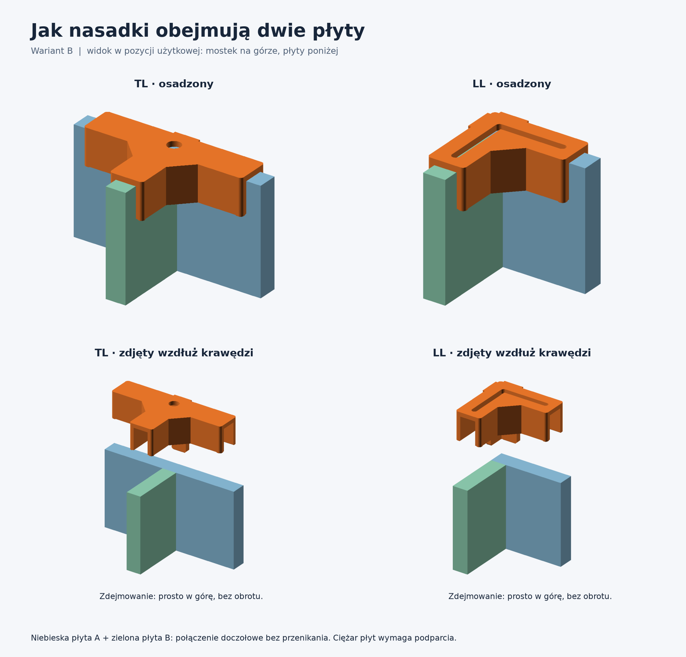

# Wydruki testowe — dobór pasowania do płyty 18 mm

Zacznij od małych próbek. Dopiero po wyborze szczeliny wydrukuj po jednym TL i LL, a następnie cały zestaw **2 TL + 4 LL**. Potrzebujesz rzeczywistej płyty, suwmiarki i kątownika.

## 1. Pobierz próbki STL

Najwygodniej wydrukować wszystkie cztery próbki na jednym stole:

**[Pobierz fit_all_4.stl — komplet czterech próbek](../stl/fit/fit_all_4.stl?raw=true).**

Możesz też pobrać je osobno:

| Oznaczenie na próbce | Całkowity dodatek do 18 mm | Projektowa szerokość szczeliny | Plik STL |
|---|---:|---:|---|
| `0.2` | 0,2 mm | 18,2 mm | [Próbka 0,2](../stl/fit/fit_18_clearance_0.2.stl?raw=true) |
| `0.3` | 0,3 mm | 18,3 mm | [Próbka 0,3](../stl/fit/fit_18_clearance_0.3.stl?raw=true) |
| `0.4` | 0,4 mm | 18,4 mm | [Próbka 0,4](../stl/fit/fit_18_clearance_0.4.stl?raw=true) |
| `0.5` | 0,5 mm | 18,5 mm | [Próbka 0,5](../stl/fit/fit_18_clearance_0.5.stl?raw=true) |

Dodatek jest **całkowity**, nie na każdą stronę. Płyta nominalnie 18 mm może mieć inną rzeczywistą grubość, więc oznaczenie `0.3` nie gwarantuje 0,3 mm wolnej przestrzeni na konkretnej płycie.

## 2. Przygotuj wydruk w Bambu Studio

Wczytaj STL jako **milimetry, skala 100%**. Zachowaj orientację pliku: płaska podstawa na stole, otwarta szczelina skierowana ku górze. Nie obracaj próbki na bok.

| Parametr | Ustawienie początkowe |
|---|---|
| Drukarka / dysza | Bambu Lab A1 mini / 0,4 mm |
| Materiał | Suchy PETG, ten sam co dla docelowych uchwytów |
| Warstwa / pierwsza warstwa | 0,20 / 0,20 mm |
| Obrysy | 6, jak dla zalecanego wariantu B |
| Górne / dolne warstwy | 6 / 6 |
| Wypełnienie | 35% gyroid |
| Podpory | Wyłączone |
| Brim | Początkowo wyłączony |
| Kompensacje wymiarów XY | Początkowo 0 |
| Temperatury i chłodzenie | Profil producenta konkretnego PETG |

Przy próbniku zbiorczym drukuj wszystkie części całymi warstwami. Sprawdź podgląd pierwszej warstwy i obrysów przed wysłaniem do drukarki. Temperatury, kalibrację i pozostałe zalecenia opisuje [instrukcja druku](printing.md).

## 3. Sprawdź pasowanie po ostygnięciu

1. Zmierz płytę w kilku miejscach, razem z okleiną. Wybierz także najgrubsze miejsce, na które będą zakładane uchwyty.
2. Poczekaj na całkowite ostygnięcie próbek. Usuń nitki i drobne zadziory, zachowując płaskie powierzchnie szczeliny.
3. Nasuwaj próbki ręką na krawędź płyty, zaczynając od najszerszej `0.5` i przechodząc do ciaśniejszych.
4. Za każdym razem doprowadź krawędź płyty do mostka. Próbka musi osadzić się na całej głębokości, nie tylko wejść na fazę wlotową.
5. Kilka razy zdejmij i załóż próbkę. Powtórz sprawdzenie w innych miejscach płyty.

**Wybierz najciaśniejszą próbkę, która daje się w pełni nasunąć i zdjąć ręką bez klinowania, wyraźnego rozginania ścian i rysowania laminatu.** Luz dodatni nie wytwarza siły zacisku; brak mocnego tarcia sam w sobie nie oznacza błędu.

Jeżeli żadna próbka nie wchodzi, zmień nominalną grubość lub dodatek w CAD i wykonaj nowy próbnik. Jeżeli wszystkie są wyraźnie za luźne, sprawdź pomiary płyty, kalibrację druku i mniejszą szczelinę. Nie poprawiaj pasowania skalowaniem procentowym STL.

Zapisz wybraną próbkę, rzeczywistą grubość płyty, materiał oraz ustawienia druku. Ta sama konfiguracja powinna zostać użyta do całego zestawu.

## 4. Przenieś wybrany luz do uchwytów

**Gotowe STL wszystkich trzech wariantów mają domyślną szczelinę 18,30 mm**, czyli `board_thickness = 18` i `clearance = 0.3`.

| Wybrana próbka | Następny krok |
|---|---|
| `0.3` | Możesz użyć dostarczonych STL uchwytów. |
| `0.2`, `0.4` lub `0.5` | Zmień `clearance` na wybraną wartość i ponownie wygeneruj uchwyty oraz układy stołów. |

Przykład dla próbki `0.4` w [src/config.scad](../src/config.scad):

```scad
variant = "reinforced";
board_thickness = 18;
clearance = 0.4;
```

Otwórz `src/handle_TL.scad` oraz `src/handle_LL.scad`, wykonaj pełny render F6 i eksportuj nowe STL. Instrukcje eksportu całego zestawu: [README](../README.md#zmiana-parametrów-i-eksport). Po każdej zmianie parametrów trzeba sprawdzić również nowe modele i gabaryty stołów. Raport z repozytorium dotyczy dostarczonej konfiguracji domyślnej.

## 5. Wydrukuj jeden TL i jeden LL

Dla domyślnego pasowania `0.3` i zalecanego wariantu B:

- [Pobierz TL_reinforced.stl](../stl/reinforced/TL_reinforced.stl?raw=true).
- [Pobierz LL_reinforced.stl](../stl/reinforced/LL_reinforced.stl?raw=true).

Przy innym wybranym luzie użyj własnych, ponownie wyeksportowanych STL. Krótka próbka nie sprawdza odkształceń długich ramion, dlatego ten etap jest konieczny przed wykonaniem całego zestawu.

Na dwóch odpadach płyt wykonaj próbny narożnik LL i połączenie z przegrodą TL:

1. Podeprzyj ciężar obu płyt. Ustaw je doczołowo pod kątem 90°, ze wspólną płaszczyzną odsłoniętych krawędzi.
2. Załóż uchwyt, wsuwając obie szczeliny jednocześnie, aż krawędzie oprą się o mostek.
3. Dosuń płyty do baz. Sprawdź kątownikiem kąt, przyleganie złącza oraz brak rozparcia płyt.
4. Sprawdź możliwość wykonania planowanego połączenia i prostoliniowego zdjęcia nasadki.
5. Załóż i zdejmij każdy uchwyt kilkanaście razy, obserwując ściany i nasady wież. Nie powinno być pęknięć, bielenia, rozwarstwień ani trwałego rozwarcia.



## 6. Wydrukuj pełny zestaw

Po pomyślnym teście pełnych uchwytów wydrukuj dwa stoły wybranego wariantu. Dla B i domyślnego luzu `0.3`:

- [Stół 1 — 1 TL + 2 LL](../stl/reinforced/plate_1_reinforced.stl?raw=true).
- [Stół 2 — 1 TL + 2 LL](../stl/reinforced/plate_2_reinforced.stl?raw=true).

Łącznie otrzymasz **2 TL + 4 LL**. Oba stoły są identyczne; można również wydrukować stół 1 dwa razy. Przy zmianie luzu użyj ponownie wygenerowanych układów.

## Co zostało dotąd sprawdzone

Przeprowadzono walidację komputerową STL, szerokości szczelin, kąta baz oraz kontaktu i braku kolizji z modelami płyt 18 mm. **Nie wykonano fizycznych wydruków, prób obciążeniowych ani krojenia w Bambu Studio.** Ta instrukcja opisuje procedurę pierwszego testu, a nie wynik już wykonanej próby warsztatowej.

Szczegóły: [walidacja](validation.md), [druk](printing.md), [użytkowanie i trwałość](usage.md).
