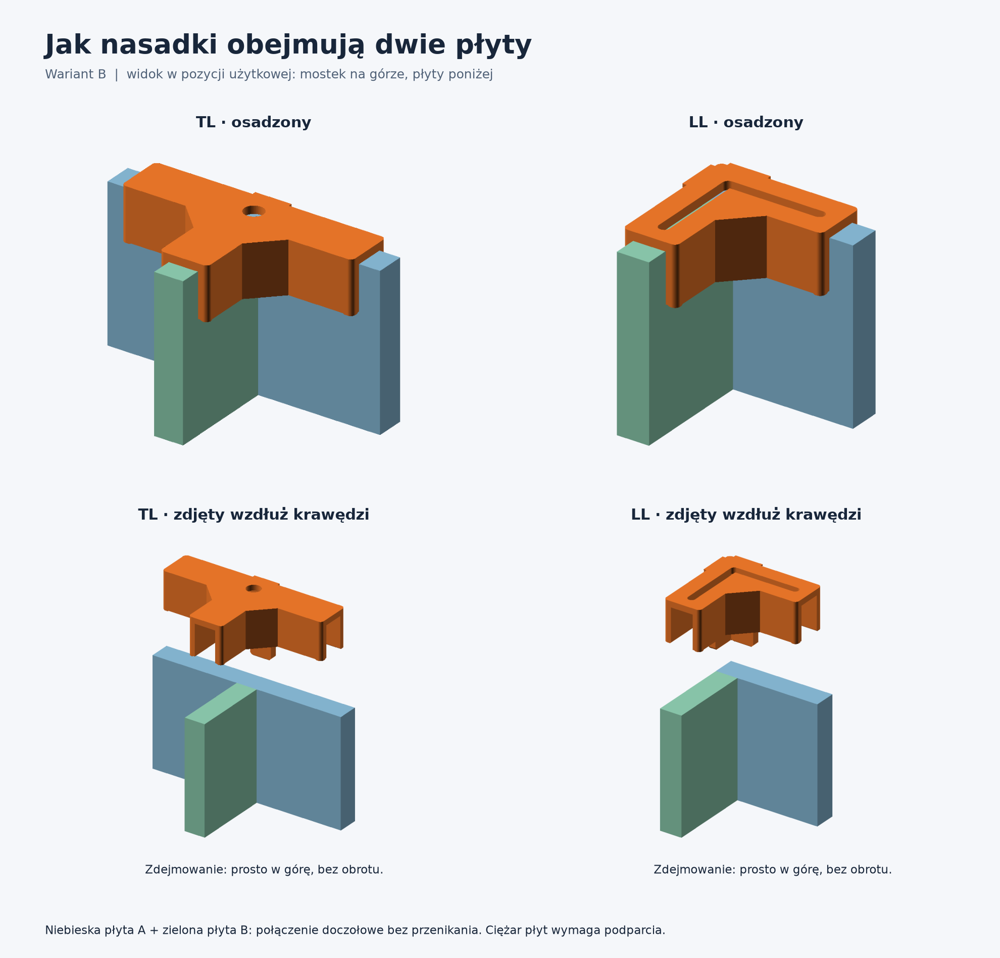

# Użytkowanie, kontakt z płytami i trwałość

## Montaż próbny

1. Ułóż dwie płyty z równymi, nieuszkodzonymi krawędziami. Oprzyj ich ciężar na stole lub podporach.
2. Ustaw połączenie doczołowe: krawędź drugiej płyty dotyka powierzchni pierwszej. Ich odsłonięte krawędzie, na które zakładasz nasadkę, powinny leżeć w jednej płaszczyźnie.
3. Dobierz TL dla przegrody pośrodku pierwszej płyty; LL dla zewnętrznego narożnika.
4. Odwróć model względem orientacji druku: płaski mostek na górze, otwarte szczeliny skierowane na krawędzie płyt. Wsuń obie szczeliny jednocześnie, do oparcia krawędzi o mostek. Wloty mają fazy ułatwiające wejście.
5. Dosuń obie płyty do zewnętrznych baz: dla A tylna ścianka szczeliny, dla B lewa ścianka jej szczeliny. [Schemat osi](dimensions.md). Sprawdź kątownikiem 90°, przyleganie czoła i zgodność z planem otworów meblowych.
6. Na długich płytach zastosuj drugą nasadkę w odsłoniętym miejscu. Dobierz pozycje tak, aby nie zasłaniały łączników i nie kolidowały ze sobą. Nie zakładaj, że pojedynczy uchwyt zablokuje skręcenie całej wysokiej ścianki.
7. Skręć elementy lub wykonaj trasowanie, zachowując podparcie. Przenieś uchwyt, jeżeli zasłania zaplanowane wiercenie.
8. Wyciągnij nasadkę prostoliniowo z krawędzi. Nie skręcaj jej na siłę i nie podważaj wieży. Przed zamontowaniem pleców lub kolejnej płyty upewnij się, że pozostanie droga zdjęcia.

Mostek ustala wspólną płaszczyznę odsłoniętych krawędzi. Jeżeli korpus wymaga cofnięcia jednej płyty, nie wymuszaj jej dosunięcia tą nasadką. Projekt nie obejmuje połączeń na ukos, nierównych grubości ani niewyrównanych krawędzi.

## Co stabilizuje konstrukcję

Dwie pary ścian ograniczają przemieszczenie w poprzek obu grubości. Długie ramiona ograniczają obrót płyt w rzucie, a głębokość chwytu ogranicza ich przechylanie. Wspólny mostek i wzmocnienia łączą oba kierunki w jedną bryłę. Przedłużenia z otworami dodatkowo podpierają fragment zewnętrznej powierzchni przy złączu.

Luz dodatni pozwala na niewielkie poruszenie; nie jest to zacisk sprężynowy. Na luźnym pasowaniu lub przy pracy na pionowej krawędzi nasadka może zsunąć się bez dodatkowego zabezpieczenia. Zastosuj podparcie albo lekki ścisk, który nie deformuje narzędzia. Jeżeli nasadka sama mocno rozpiera się na płycie, wybierz większą szczelinę zamiast wciskania.

## Otwory pomocnicze

Wszystkie osie leżą w odstępach 15 mm wzdłuż odsłoniętej krawędzi płyty. Pierwsza oś jest 10 mm od mostka, kolejne 25 i 40 mm. Nie jest to standard rozstawu okuć ani system 32. Przed użyciem wyznacz, dokąd trafi oś konkretnego otworu.

W TL seria w zewnętrznej ścianie leży na osi grubości przegrody. Przy pokazanym połączeniu LL do prowadzenia od strony szerokiej płyty A użyteczna jest seria w ścianie Y=0. Druga seria LL służy po lustrzanym odwróceniu rodzaju zakładki płyt; nie zakładaj, że obie serie równocześnie wskazują prawidłowy tor wkrętu w tym samym połączeniu.

Otwory mają okrąg nominalny Ø6,65 i daszek ku górze w orientacji druku. Do trasowania użyj pasującego punktaka. Narzędzie samocentrujące może opierać **nieruchomą osłonę** o otwór wyłącznie wtedy, gdy jej rzeczywista średnica i zakres pracy pasują, a wiertło obraca się bez dotykania PETG. Nie dostarczono konkretnego wiertła i nie sprawdzono kompatybilności jego osłony.

Obracające się wiertło może rozwiercić tworzywo, rozgrzać je i stracić osiowość. Te otwory nie są precyzyjnymi tulejami wiertarskimi. Do regularnego wiercenia wymagającego dokładności zastosuj osobny właściwy przyrząd. Nie ma konieczności dokupowania tulejek do samej funkcji pozycjonowania.

## Kontrola pierwszego kompletu

- Sprawdź suwmiarką, czy szczeliny są zbliżone do wybranej próbki na całej długości.
- Sprawdź pełne osadzenie obu płyt, brak ich rozparcia oraz brak szczeliny w złączu.
- Kątownikiem skontroluj obie strony narożnika i przegrody. Dla bardzo długiego korpusu dodatkowo sprawdź przekątne.
- Załóż i zdejmij nasadkę kilkanaście razy ręką. Obserwuj bielenie, pęknięcia, odwarstwienia i trwałe rozwarcie ścian.
- Na podpartych odpadach zasymuluj własny sposób montażu. Nie wyznaczono dopuszczalnej siły, momentu ani liczby cykli.

## Trwałość

Nie przechowuj nasadek stale rozgiętych na płytach; PETG może pełzać pod długotrwałym obciążeniem. Chroń je przed wysoką temperaturą i uderzeniami w wystające wieże. Usuwaj trociny, nitki i klej z powierzchni styku, aby nie porysować laminatu i nie zmienić pasowania. Nie szlifuj baz bez ponownego pomiaru kąta.

Po zauważeniu pęknięcia, odwarstwienia lub trwałego rozwarcia wymień część. W warsztacie wybierz B; C wykorzystuj do lżejszych i mniejszych elementów, gdy krótsza powierzchnia kontaktu jest wystarczająca. Żaden wariant nie zastępuje właściwego ścisku do przenoszenia dużych obciążeń.
